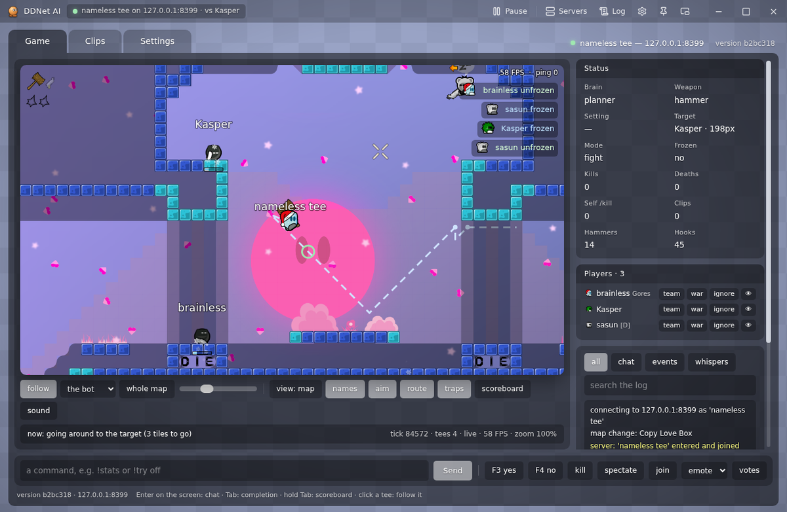
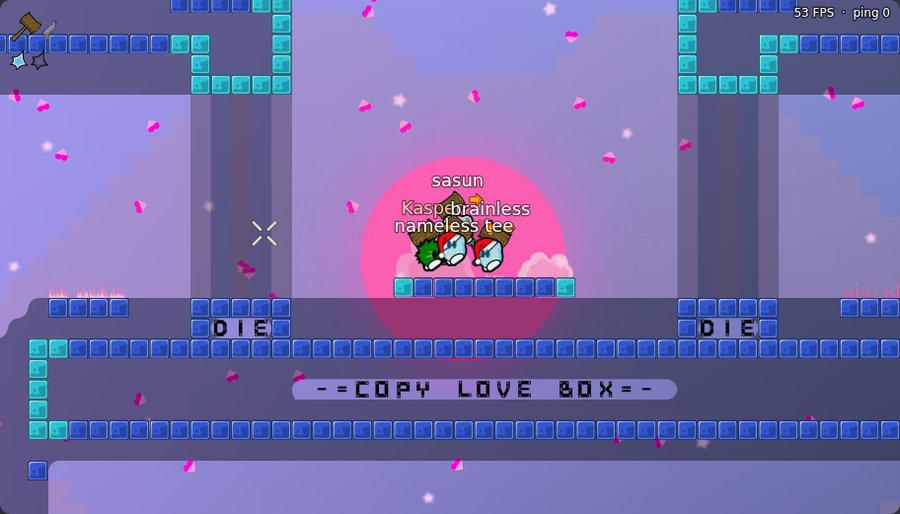
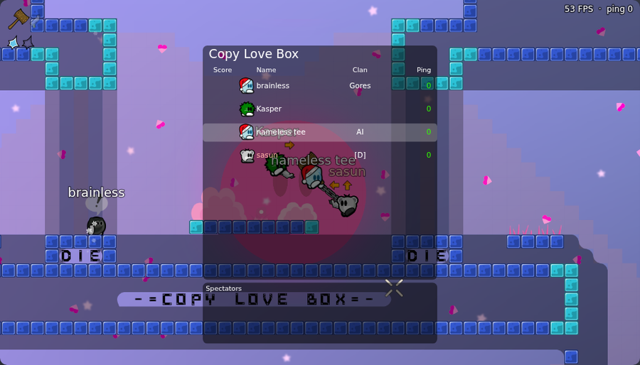
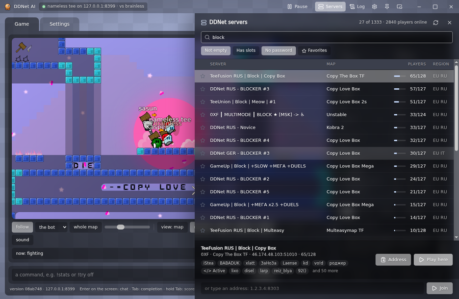
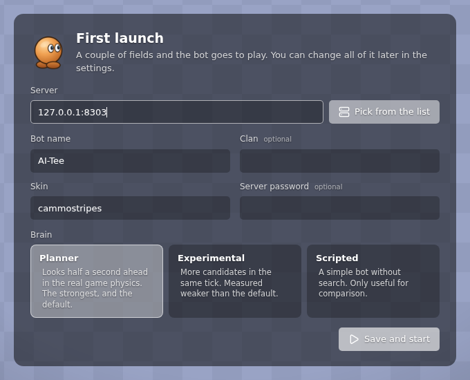
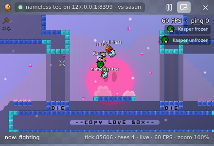

# DDNet AI

**A bot that plays block in DDNet by itself**

It throws the hook, swings the hammer, puts opponents into freeze and gets itself out of it. 
Every move is checked in the game's real physics, 25 times a second.

[Русский](README.md) · **English** · [Project page](https://wranked1.github.io/DDNet-AI/en/)

[Quick start](#quick-start) · [The window](#the-window) · [How it plays](#how-it-plays) · [Controls](#controls) · [FAQ](#faq)

## Quick start

> [!CAUTION]
> **Official DDNet AI builds are distributed only through this repository and its GitHub Releases.** Builds from Telegram, Discord, file-sharing sites, or other repositories are unofficial and may be modified by third parties. If you did not get the file here, do not run it. Releases publish `SHA256SUMS.txt`; verify the hash before running.

1. Download **`ddnet-ai.zip`** from the [latest release](https://github.com/Wranked1/DDNet-AI/releases/latest) and unpack it anywhere.
2. Double-click **`DDNet AI.exe`**.

Nothing else to install: the window and Node.js are inside. The window restarts the bot if it falls over, and keeps it updated.

> [!NOTE]
> `DDNet AI.exe` is not code-signed, so the first time Windows may show "Windows protected your PC". Click "More info", then "Run anyway".

The bot asks for its name, clan and skin, then goes to play. The server field can stay empty: the bot then joins the liveliest block server without a password by itself, and moves on when that one empties. The answers are saved in `settings.json`, and next time it joins the server by itself.

The window speaks English or Russian: it follows the system, and the language is also a setting (Settings, App, Language). The bot's page, its replies and its console follow the window.

<b>Linux and macOS</b>

 

**Linux (x86_64):** the window is here too, and Node.js does not have to be installed.

1. Download **`ddnet-ai-linux.tar.gz`** from the [latest release](https://github.com/Wranked1/DDNet-AI/releases/latest) and unpack it: `tar xzf ddnet-ai-linux.tar.gz`.
2. Run `./"DDNet AI.sh"` in the `ddnet-ai` folder (if it does not run, for example after an older updater copied it without the executable bit, run `chmod +x "DDNet AI.sh"` once or start it as `sh "DDNet AI.sh"`). To get DDNet AI into the applications menu, run `./"DDNet AI.sh" --install-desktop` once; the `ddnet-ai.desktop` file in the folder also opens with a double-click, but GNOME may ask you to "Allow Launching".

The window updates with the bot, as on Windows; if a new version asks for another Electron, `DDNet AI.sh` downloads it at launch. If the kernel does not allow Chromium's sandbox (Ubuntu 24.04, for one), the script starts the window without it: the window opens only its own pages and the bot's page on `127.0.0.1`. The tray icon shows where there is a notification area (KDE, XFCE, GNOME with the AppIndicator extension); without one the close button closes the window. Under Wayland the global pause key may not work, and the window has a pause button. Starting with the system is not supported on Linux yet.

Without the window, in a console (a headless server, macOS): install [Node.js](https://nodejs.org) 24 or newer and run `./run.sh` in the bot's folder. The bot's page opens in the browser at `http://localhost:7777`, and you can type commands in the console. The desktop window is not built for macOS yet.

## The window

<table>
  <tr>
    <td width="50%"></td>
    <td width="50%"></td>
  </tr>
  <tr>
    <td align="center">The game in DDNet's graphics: skins, hook, freeze, names over the players</td>
    <td align="center">Scoreboard, freeze feed, ping</td>
  </tr>
  <tr>
    <td></td>
    <td></td>
  </tr>
  <tr>
    <td align="center">DDNet servers, searchable by map, mode and player name</td>
    <td align="center">First launch: a couple of fields and the bot goes to play</td>
  </tr>
</table>

- **The game as in the client.** The map, skins, hook, hammer and emotes are drawn with the graphics of your own DDNet install. The camera follows the bot or any player.
- **Servers.** The whole DDNet list with search, filters and favorites. "Play here" moves the bot to the chosen server.
- **Pause from anywhere.** From the window, the tray, the taskbar thumbnail and with <kbd>Ctrl</kbd>+<kbd>Shift</kbd>+<kbd>F9</kbd> from any program, even from the game itself.
- **Team, war and ignore.** Every player on the server has buttons: "team" (the bot leaves them alone), "war" (it always goes for them), "ignore" (it neither touches nor answers them). The same lists as `!friend`, `!war` and `!ignore`.
- **Keys for the bot.** <kbd>F3</kbd> and <kbd>F4</kbd> vote for it, and buttons make it `/kill`, go to the spectators, show an emote or call a server vote.
- **Mini mode.** A small window on top of everything, to watch the bot while you play yourself.
- **Log and notifications.** The bot disconnected, came back, updated: the window tells you.
- **A bug report.** "Collect a bug report" puts the clips, map memory and the demos you pick into one zip on the desktop. The server password stays out of it.
- **Proxies.** In Settings, the Server section, each bot can have its own SOCKS5 proxy (it has to be SOCKS5 with UDP: HTTP proxies do not carry the game), so the two bots join from different addresses.

 Mini mode over the game

## How it plays

The bot keeps its own copy of DDNet 20 physics and on every step runs dozens of options half a second ahead in it: where to run, when to jump, where and when to throw the hook, when to hit. It picks the one after which the opponent is closer to freeze and the bot itself is further from it.

| | |
|---|---|
| **Hooks from a distance** | throws the hook from afar, like strong players do, instead of walking up close |
| **Holds and drags** | leads the opponent on the hook to the freeze and finishes with the hammer |
| **Minds its ping** | rolls the world forward by its own delay, counting the keys already on their way to the server |
| **Picks its target** | does not stick to someone already frozen when a free one is nearby |
| **Gets out by itself** | if it is stuck in freeze and nobody saves it, it does `/kill` |

> [!NOTE]
> The bot does not look at the screen and presses nothing for you. It is a separate player: it joins the server by itself, like a normal client, and you can play DDNet on the same computer at the same time.

## Controls

| Keys | What they do |
|---|---|
| <kbd>Ctrl</kbd>+<kbd>Shift</kbd>+<kbd>F9</kbd> | pause and resume from any program (can be changed in the settings) |
| <kbd>F3</kbd>, <kbd>F4</kbd> | vote yes / no for the bot, while the bot's window is focused |
| <kbd>Esc</kbd> | close the servers or settings panel |
| double-click the title bar | maximize the window |

<b>Bot commands</b>

 

Typed into the window's command line or into the console. They never reach the game chat. Anything typed without `!` the bot says in the chat under its own name.

| Command | What it does |
|---|---|
| `!stop`, `!go` | stop / carry on |
| `!mode fight`, `passive`, `hold` | fight / touch nobody / hold the position |
| `!target <name>`, `!target -` | fight only this player / clear it |
| `!war <name>`, `!friend <name>`, `!ignore <name>` | always hit / never touch / never touch and never answer |
| `!clanwar <clan>`, `!clanfriend <clan>` | the same by clan |
| `!home <x> <y>` | where to go back to when there is nobody to fight |
| `!goto tele`, `!goto <x> <y>` | walk to the teleporter or to a point |
| `!clip [note]` | save the last 30 seconds of the game to a file |
| `!stats`, `!where` | counters / where the bot is and whom it fights |
| `!emote <name>` | show an emote |
| `!yes`, `!no`, `!votes`, `!vote <name>` | vote like F3 / F4, list the server's votes, call one |
| `!spec`, `!join` | go to the spectators / back into the game |
| `!kill`, `!reset` | kill itself and respawn |
| `!lang en`, `!lang ru` | the language of the console and the bot's page |
| `!quit` | quit |

## From a phone

The bot can stay on the computer while you watch and control it from a phone: the bot's page opens in the phone's browser over Wi-Fi, with the game, the menu and the settings, as on the computer.

1. Turn on **"Access from the local network"**: in the window, section "Bot", or on the bot's page, tab "Settings", card "From a phone" (or start with the `--lan` flag; in `settings.json` it is `"lan": "on"`). It is off by default.
2. The same place shows an address like `http://192.168.1.5:7777/`, a QR code and a six-digit code. The phone and the computer must be on the same network.
3. Open the address on the phone (or point the camera at the QR) and enter the code. The code is entered once: the phone stays signed in until the bot is restarted or the code is replaced with "New code".

The bot listens only on the network's private addresses (10.x, 172.16-31.x, 192.168.x), nothing opens from a phone without the code, and five wrong codes in a row close the sign-in for a minute. Turn it on only on a home network: on someone else's Wi-Fi anyone who sees the address can try codes. The addresses are found at start: if you change network, restart the bot. VPN adapters (WireGuard, OpenVPN, Tailscale and the like, by name) are skipped so the page does not open to everyone on the VPN. Twenty wrong codes in ten minutes (from any devices) close the sign-in for ten minutes; after fifty wrong ones the bot changes the code by itself (phones already signed in stay). Turning "Access from the local network" off signs every phone out. The connection is plain http, unencrypted: on an open Wi-Fi the code and the page can be seen by anyone nearby. If the page does not open, check that the Windows firewall is not blocking port 7777 (on the first start it asks about Node.js: allow it on private networks).

## Updates

Nothing to do. The bot checks for a new version when it starts and every five minutes after, downloads it and restarts by itself, and the window updates with it. Settings, clips and map memory are left alone.

## FAQ

<b>The bot jumped into freeze by itself or plays strangely. How can I help?</b>

 

Click the tray icon and choose "Collect a bug report". A zip with the clips that show what went wrong appears on the desktop. If you recorded a demo, add it too.

<b>Does it need a graphics card?</b>

 

No. The bot thinks on the processor, and any graphics card is enough for the window.

<b>A server with a password?</b>

 

Type the password at the first launch or in the settings. It is kept only on your computer and is cleared when you move to another server.

<b>Where are the settings and recordings?</b>

 

| Path | What is there |
|---|---|
| `settings.json` | server, name, clan, skin, language |
| `runs/clips` | recordings of moments from the game |
| `runs/memory` | what the bot remembers about maps |
| `app-win`, `app-linux` | the window itself (Electron), which `DDNet AI.exe` opens (Linux: `DDNet AI.sh`) |

## Support

DDNet AI is free and earns me nothing: I build it in my spare time. If the bot has been useful to you, you can support the project with crypto. It gives me the motivation to keep developing it.

| Network | Address |
|---|---|
| BTC | `bc1qpkaeksf84tsmg8ma9thajdr3g07eghe9kedals` |
| TON | `UQAGz-ZisbbkNcUYxt98RPeZu7zxOfrfKFatfQr0Cn6209kg` |
| SOL | `5GKAETatYe2knHJ5FtKpd1w4NgXgR1a5QAz4rBk5gJV8` |
| BSC | `0x295Ed37F5C9f120ce37b511A7e69f2cd0432bB89` |
| TRON | `TBJNNRDXoaxNyxktfJoTAD8jcYMt2dJcSS` |
| ETH | `0x295Ed37F5C9f120ce37b511A7e69f2cd0432bB89` |

BSC and ETH share one address (EVM networks). Check the network before sending. The wallets are in the window too: Settings → "Support me".

## License

GPL-3.0 (see [LICENSE](LICENSE) and [NOTICE](NOTICE)). You may run, study and change the bot. Whoever publishes a version of it, changed or not, must name this project as the original and publish their source under the same license. The physics ported from DDNet stays under DDNet's license (zlib), the libraries under their own.

## Credits

- [DDNet](https://ddnet.org) and Teeworlds: the bot's physics is ported from the DDNet 20 sources (zlib license), and the window takes the graphics and sounds from your install of the game. The screenshots show DDNet graphics (CC-BY-SA 3.0).
- [Electron](https://www.electronjs.org) (MIT) and [Lucide](https://lucide.dev) icons (ISC).
