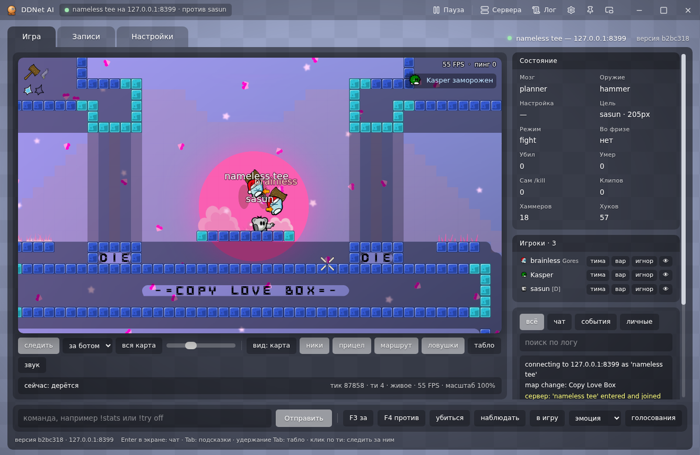
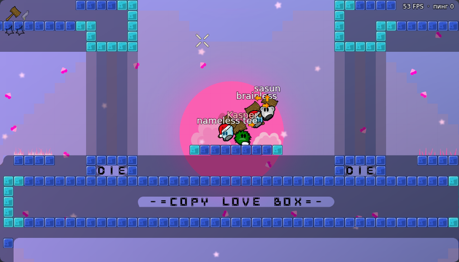
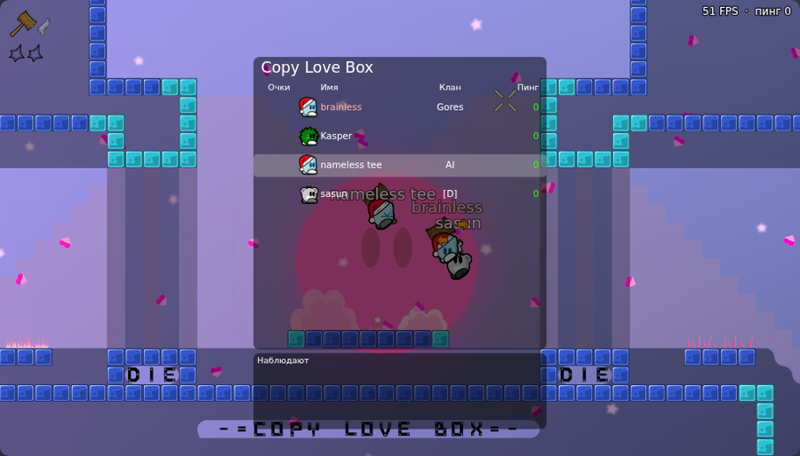
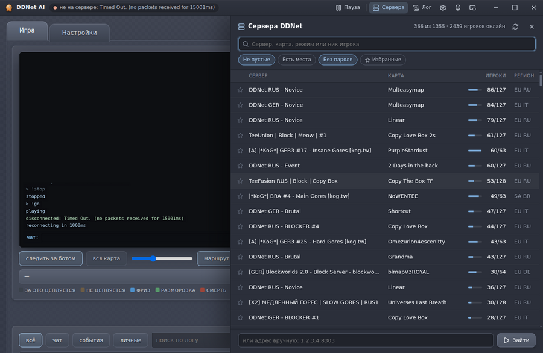
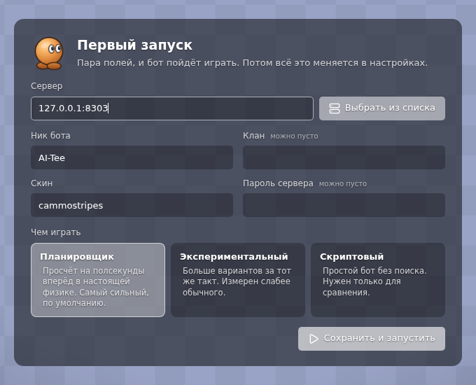
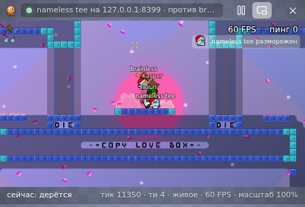

# DDNet AI

**Бот, который сам играет в блок в DDNet**

Кидает хук, бьёт молотом, закидывает соперников во фриз и выбирается из него. 
Каждый ход он проверяет в настоящей физике игры, 25 раз в секунду.

**Русский** · [English](README.en.md) · [Сайт проекта](https://wranked1.github.io/DDNet-AI/)

[Быстрый старт](#быстрый-старт) · [Окно](#окно) · [Как он играет](#как-он-играет) · [Управление](#управление) · [Вопросы](#вопросы)

## Быстрый старт

> [!CAUTION]
> **Официальный DDNet AI распространяется только через этот репозиторий и его GitHub Releases.** Сборки из Telegram, Discord, файлообменников и других репозиториев не являются официальными и могут быть изменены третьими лицами. Если файл получен не отсюда — не запускай его. Для релизов публикуется `SHA256SUMS.txt`; проверяй хеш перед запуском.

1. Скачай **`ddnet-ai.zip`** из [последнего релиза](https://github.com/Wranked1/DDNet-AI/releases/latest) и распакуй в любую папку.
2. Дважды щёлкни **`DDNet AI.exe`**.

Больше ничего ставить не нужно: окно и Node.js уже внутри. Окно само перезапускает бота, если тот упал, и обновляет его.

> [!NOTE]
> У `DDNet AI.exe` нет цифровой подписи, поэтому в первый раз Windows может показать «Система Windows защитила ваш компьютер». Нажми «Подробнее», затем «Выполнить в любом случае».

Бот спросит ник, клан и скин, а потом пойдёт играть. Поле сервера можно оставить пустым: бот сам зайдёт на самый живой блок-сервер без пароля и перейдёт на другой, если этот опустеет. Ответы сохраняются в `settings.json`, и в следующий раз он зайдёт на сервер сам.

Окно говорит по-русски и по-английски: язык берётся из системы и меняется в настройках (Настройки, Приложение, Язык). Страница бота, его ответы и консоль переходят на тот же язык.

<b>Linux и macOS</b>

 

**Linux (x86_64):** окно есть и здесь, Node.js ставить не нужно.

1. Скачай **`ddnet-ai-linux.tar.gz`** из [последнего релиза](https://github.com/Wranked1/DDNet-AI/releases/latest) и распакуй: `tar xzf ddnet-ai-linux.tar.gz`.
2. Запусти `./"DDNet AI.sh"` из папки `ddnet-ai` (если файл не запускается, например после обновления бота старой версией, выполни один раз `chmod +x "DDNet AI.sh"` или запусти `sh "DDNet AI.sh"`). Чтобы DDNet AI появился в меню приложений, один раз выполни `./"DDNet AI.sh" --install-desktop`; файл `ddnet-ai.desktop` из папки тоже открывается двойным щелчком, но GNOME может спросить «Разрешить запуск» (Allow Launching).

Окно обновляется вместе с ботом, как в Windows; если новая версия просит другой Electron, `DDNet AI.sh` сам скачает его при запуске. Если ядро запрещает Chromium песочницу (например, Ubuntu 24.04), скрипт сам запускает окно без неё: окно открывает только свои страницы и страницу бота на `127.0.0.1`. Значок в трее появляется там, где есть область уведомлений (KDE, XFCE, GNOME с расширением AppIndicator); без неё крестик закрывает окно. Под Wayland глобальная клавиша паузы может не работать, пауза есть в окне. Запуск вместе с системой на Linux пока не поддерживается.

Без окна, в консоли (сервер без экрана, macOS): поставь [Node.js](https://nodejs.org) 24 или новее и запусти `./run.sh` из папки бота. Страница бота откроется в браузере на `http://localhost:7777`, а в консоли можно писать команды. Окно-приложение для macOS пока не собирается.

## Окно

<table>
  <tr>
    <td width="50%"></td>
    <td width="50%"></td>
  </tr>
  <tr>
    <td align="center">Игра в графике DDNet: скины, хук, фриз, ники над игроками</td>
    <td align="center">Таблица игроков, лента заморозок, пинг</td>
  </tr>
  <tr>
    <td></td>
    <td></td>
  </tr>
  <tr>
    <td align="center">Сервера DDNet с поиском по карте, режиму и нику игрока</td>
    <td align="center">Первый запуск: пара полей, и бот идёт играть</td>
  </tr>
</table>

- **Игра как в клиенте.** Карта, скины, хук, молот и эмоции рисуются графикой из твоей установки DDNet. Камера следит за ботом или за любым игроком.
- **Сервера.** Весь список DDNet с поиском, фильтрами и избранным. Кнопка «Играть здесь» переносит бота на выбранный сервер.
- **Пауза отовсюду.** Из окна, из трея, с миниатюры в панели задач и клавишами <kbd>Ctrl</kbd>+<kbd>Shift</kbd>+<kbd>F9</kbd> из любой программы, даже из самой игры.
- **Тима, вары и игнор.** У каждого игрока сервера кнопки: «тима» (бот его не трогает), «вар» (бьёт всегда), «игнор» (не трогает и не отвечает). Те же списки, что у `!friend`, `!war` и `!ignore`.
- **Кнопки за бота.** <kbd>F3</kbd> и <kbd>F4</kbd> голосуют за него, кнопками он делает `/kill`, уходит в наблюдатели, показывает эмоцию или ставит голосование сервера.
- **Мини-режим.** Маленькое окно поверх всех, чтобы смотреть за ботом, пока играешь сам.
- **Лог и уведомления.** Бот отключился, вернулся на сервер, обновился: окно скажет.
- **Отчёт об ошибке.** Кнопка «Собрать отчёт об ошибке» складывает клипы, память карт и выбранные демки в один zip на рабочем столе. Пароль сервера туда не попадает.
- **Прокси.** В Настройках, раздел «Сервер», каждому боту можно задать свой SOCKS5-прокси (нужен SOCKS5 с UDP: HTTP-прокси игру не пропускают), и два бота зайдут с разных адресов.

 Мини-режим поверх игры

## Как он играет

Бот держит у себя копию физики DDNet 20 и на каждом шаге прогоняет в ней десятки вариантов на полсекунды вперёд: куда бежать, когда прыгнуть, куда и когда кинуть хук, когда ударить. Выбирает тот, после которого соперник ближе к фризу, а сам бот дальше от него.

| | |
|---|---|
| **Хук с дистанции** | кидает хук издалека, как сильные игроки, а не подходит вплотную |
| **Держит и тащит** | ведёт соперника на хуке к фризу и добивает молотом |
| **Учитывает пинг** | прокручивает мир вперёд на свою задержку, с учётом нажатий, которые уже летят на сервер |
| **Выбирает цель** | не держится за уже замороженного, когда рядом есть свободный |
| **Выбирается сам** | если застрял во фризе и никто не спасает, делает `/kill` |

> [!NOTE]
> Бот не видит экран и ничего не нажимает за тебя. Это отдельный игрок: он заходит на сервер сам, как обычный клиент, и ты можешь в это время играть в DDNet на том же компьютере.

## Управление

| Клавиши | Что делают |
|---|---|
| <kbd>Ctrl</kbd>+<kbd>Shift</kbd>+<kbd>F9</kbd> | пауза и продолжение из любой программы (меняется в настройках) |
| <kbd>F3</kbd>, <kbd>F4</kbd> | голос за / против от бота, когда окно бота в фокусе |
| <kbd>Esc</kbd> | закрыть панель серверов или настроек |
| двойной щелчок по заголовку | развернуть окно |

<b>Команды бота</b>

 

Пишутся в строке команд окна или в консоли. В игровой чат они не уходят. Всё, что написано без `!`, бот скажет в чат от своего имени.

| Команда | Что делает |
|---|---|
| `!stop`, `!go` | остановиться / продолжить |
| `!mode fight`, `passive`, `hold` | драться / никого не трогать / держать позицию |
| `!target <ник>`, `!target -` | драться только с этим игроком / снять |
| `!war <ник>`, `!friend <ник>`, `!ignore <ник>` | бить всегда / не трогать / не трогать и не отвечать |
| `!clanwar <клан>`, `!clanfriend <клан>` | то же по клану |
| `!home <x> <y>` | куда возвращаться, когда драться не с кем |
| `!wb auto`, `!wb left`, `right`, `off` | держать ВБ на Copy Love Box: сам берёт сторону, где меньше игроков, держит её и кидает входящих во фриз; `!wb` без слова показывает, что сейчас |
| `!duel on`, `off`, `auto` | дуэль 1 на 1: без ВБ и без походов; auto включает сама после принятой дуэли |
| `!style default`, `wb`, `duel` | три способа играть из окна: как обычно, ВБ, дуэль |
| `!d <команда>` | команда второму боту (дамми), например `!d wb left` |
| `!goto tele`, `!goto <x> <y>`, `!goto <ник>` | дойти до телепорта, до точки или до игрока (идёт за ним, пока не дойдёт) |
| `!clip [заметка]` | сохранить последние 30 секунд игры в файл |
| `!stats`, `!where` | счётчики / где бот и с кем дерётся |
| `!emote <имя>` | показать эмоцию |
| `!yes`, `!no`, `!votes`, `!vote <имя>` | голос как F3 / F4, список голосований сервера, поставить одно |
| `!spec`, `!join` | в наблюдатели / обратно в игру |
| `!kill`, `!reset` | убиться и возродиться |
| `!lang ru`, `!lang en` | язык консоли и страницы бота |
| `!quit` | выйти |

## С телефона

Бота можно держать на компьютере, а смотреть и управлять им с телефона: страница бота откроется в браузере телефона по Wi-Fi, с игрой, меню и настройками, как на компьютере.

1. Включи **«Доступ из локальной сети»** на странице бота: вкладка «Настройки», карточка «С телефона» (или в окне, раздел «Бот», и перезапусти бота; или запусти с флагом `--lan`; в `settings.json` это `"lan": "on"`). По умолчанию выключено.
2. На странице бота, в той же карточке, покажутся адрес вида `http://192.168.1.5:7777/`, QR-код и шестизначный код. Телефон и компьютер должны быть в одной сети.
3. Открой адрес на телефоне (или наведи камеру на QR) и введи код. Код вводится один раз: телефон остаётся внутри, пока бот не перезапущен и пока код не заменён кнопкой «Новый код».

Бот слушает только частные адреса сети (10.x, 172.16-31.x, 192.168.x), без кода с телефона ничего не открывается, а пять неверных кодов подряд закрывают вход на минуту. Включай это только в домашней сети: в чужом Wi-Fi любой, кто видит адрес, может пробовать коды. Адреса определяются при запуске: сменил сеть, перезапусти бота. Адаптеры VPN (WireGuard, OpenVPN, Tailscale и подобные, по имени) пропускаются, чтобы страница не открылась всем участникам VPN. Двадцать неверных кодов за десять минут (с любых устройств) закрывают вход на десять минут; после пятидесяти неверных бот сам меняет код (телефоны, уже вошедшие, остаются). Выключение «Доступа из локальной сети» выходит со всех телефонов. Соединение идёт по обычному http без шифрования: в открытом Wi-Fi код и страница видны всем рядом. Если страница не открывается, проверь, не блокирует ли порт 7777 брандмауэр Windows (при первом включении он спросит разрешение для Node.js: разреши для частных сетей).

## Обновление

Ничего делать не нужно. Бот проверяет новую версию при запуске и дальше раз в пять минут, скачивает её и перезапускается сам, а окно обновляется вместе с ним. Настройки, записи и память карт при этом не трогаются.

## Вопросы

<b>Бот сам прыгнул во фриз или играет странно. Как помочь?</b>

 

Щёлкни значок в трее и выбери «Собрать отчёт об ошибке» (или Настройки → «О программе» → «Собрать отчёт об ошибке»). На рабочем столе появится zip: клипы, в которых видно, что пошло не так, память карт, лог окна и `settings.json` без паролей, прокси и ключей; демки ты выбираешь сам. Если писал демку, добавь её туда же. Приложи zip к [сообщению на GitHub](https://github.com/Wranked1/DDNet-AI/issues/new/choose) и напиши карту, пинг и что случилось. Пока бот играет, `!clip` сохраняет последние 30 секунд в `runs/clips`.

<b>Windows пишет «Система Windows защитила ваш компьютер» (SmartScreen)</b>

 

У `DDNet AI.exe` нет цифровой подписи, поэтому SmartScreen предупреждает при первом запуске. Нажми «Подробнее», затем «Выполнить в любом случае». Перед этим убедись, что файл скачан отсюда, из GitHub Releases, и сверь хеш: в PowerShell `Get-FileHash .\ddnet-ai.zip -Algorithm SHA256`, результат должен совпасть со строкой в `SHA256SUMS.txt` того же релиза. Если хеши разные, не запускай.

<b>Антивирус ругается на файл</b>

 

Программа без подписи, внутри Electron и Node.js, и антивирусы иногда считают такое подозрительным. Сначала сверь хеш (см. выше): если он совпал, файл настоящий. Если нет, удали его и скачай заново с [страницы релизов](https://github.com/Wranked1/DDNet-AI/releases/latest). Исходный код открыт, его можно прочитать. Если после совпавшего хеша антивирус всё же блокирует запуск, разреши папку бота в его исключениях.

<b>Бот зашёл на сервер, но стоит на месте</b>

 

Посмотри строку состояния на странице бота (в окне она снизу): «цели нет» значит, что драться не с кем. Бот не трогает:

- игроков, которые ничего не нажимали больше 10 секунд (AFK), и тех, кто в наблюдателях или на паузе;
- друзей (`!friend`, кнопка «тима») и игнорируемых;
- всех, если режим `!mode passive` или `!mode hold`, если ты поставил паузу (<kbd>Ctrl</kbd>+<kbd>Shift</kbd>+<kbd>F9</kbd>, `!stop`) или задан `!target`, а этого игрока рядом нет (бот бьёт только его).

На карте с ВБ бот, когда драться не с кем, встаёт на ВБ и держит его (с заданным `!home` ВБ не держит, а возвращается в эту точку). Если вместе с этим в строке состояния горит «ПК не успевает» (см. ниже про пинг), бот просто не поспевает считать.

<b>«На этой карте нет ВБ»</b>

 

ВБ (вейблок) бот держит только на Copy Love Box и её копиях с тем же залом (JoniTee, Copy The Box TF, Copy Love Box 2s, Mega и некоторые другие). Команда `!wb` скажет, что есть на этой карте. Если карта с таким же названием, но другой версии, бот проверяет её по плиткам (зал, труба с качелью, выход) и, если что-то отличается, не держит её и пишет об этом в журнале. На остальных картах бот просто дерётся там, где идёт игра. `!wb off`, `!wb left`, `!wb right` и `!wb auto` задают сторону.

<b>Какой пинг показан и почему бот лагает</b>

 

Пинг на табло и в окне это то, что сообщает сам сервер о соединении бота. Бот прокручивает свой мир вперёд на свою измеренную задержку (без замера на этот пинг), но не больше чем на 6 тиков (120 мс): дальше предсказание превращается в выдумку. Если пинг стабильно выше, дело в сети (проверь Wi-Fi, VPN, прокси) или в самом сервере. Если пинг огромный (сотни и тысяча), а бот стоит на месте и на странице горит «ПК не успевает», процессору не хватает сил: включи «Режим для слабого ПК» (галочка на странице бота, или `!low on`). Бот сам его не включает, а если включён «Сильный режим» и бот не успевает, выключи его (`!strong off`).

<b>Прокси не работает</b>

 

Нужен SOCKS5-прокси **с поддержкой UDP** (UDP ASSOCIATE): игра идёт по UDP, а HTTP-прокси, SOCKS4 и многие «SOCKS5 только для браузера» его не пропускают. Бот напишет в журнале «Прокси не поддерживает UDP» или «Нужен SOCKS5-прокси». Формат: `socks5://логин:пароль@хост:порт` или `хост:порт`. Пароль прокси не попадает в отчёт об ошибке.

<b>Linux: нет значка в трее, окно не открывается</b>

 

Значок в трее появляется только там, где есть область уведомлений (KDE, XFCE, GNOME с расширением AppIndicator). Без неё крестик закрывает окно вместе с ботом, а пауза есть кнопкой в окне. Если Chromium запрещает песочницу (например, Ubuntu 24.04), `DDNet AI.sh` сам запускает окно без неё; свой выбор можно задать переменной: `DDNET_AI_SANDBOX=0 ./"DDNet AI.sh"` без песочницы, `DDNET_AI_SANDBOX=1` с ней. Если файл не запускается, `chmod +x "DDNet AI.sh"`. Подробнее в разделе «Linux и macOS» выше.

<b>Телефон не открывает страницу бота</b>

 

Проверь по порядку: включён ли «Доступ из локальной сети» (по умолчанию выключен; если включал в окне, перезапусти бота, а адрес и QR-код ищи на странице бота: «Настройки», карточка «С телефона»), телефон и компьютер в одной сети (не в гостевой Wi-Fi и не в мобильной), адрес с портом (`http://192.168.x.x:7777/`, именно `http`), и не блокирует ли порт 7777 брандмауэр Windows (разреши Node.js для частных сетей). Сменил сеть или включил VPN: перезапусти бота, адреса определяются при запуске. Подробнее в разделе «С телефона».

<b>Нужна ли видеокарта?</b>

 

Нет. Бот считает на процессоре, окну хватает любой видеокарты.

<b>Сервер с паролем?</b>

 

Впиши пароль при первом запуске или в настройках. Он хранится только на твоём компьютере и стирается, когда переходишь на другой сервер.

<b>Где настройки и записи?</b>

 

| Путь | Что там |
|---|---|
| `settings.json` | сервер, ник, клан, скин, язык |
| `runs/clips` | записи моментов игры |
| `runs/memory` | что бот запомнил о картах |
| `app-win`, `app-linux` | само окно (Electron), его запускает `DDNet AI.exe` (Linux: `DDNet AI.sh`) |

## Поддержать

DDNet AI бесплатный и не приносит мне денег: я делаю его в свободное время. Если бот тебе пригодился, можешь поддержать проект криптой. Так у меня будет мотивация развивать его дальше.

| Сеть | Адрес |
|---|---|
| BTC | `bc1qpkaeksf84tsmg8ma9thajdr3g07eghe9kedals` |
| TON | `UQAGz-ZisbbkNcUYxt98RPeZu7zxOfrfKFatfQr0Cn6209kg` |
| SOL | `5GKAETatYe2knHJ5FtKpd1w4NgXgR1a5QAz4rBk5gJV8` |
| BSC | `0x295Ed37F5C9f120ce37b511A7e69f2cd0432bB89` |
| TRON | `TBJNNRDXoaxNyxktfJoTAD8jcYMt2dJcSS` |
| ETH | `0x295Ed37F5C9f120ce37b511A7e69f2cd0432bB89` |

BSC и ETH: один и тот же адрес (сети EVM). Перед отправкой проверь сеть. Кошельки есть и в окне: Настройки → «Поддержать».

## Лицензия

GPL-3.0 (файлы [LICENSE](LICENSE) и [NOTICE](NOTICE)). Бота можно запускать, изучать и переделывать. Но кто выкладывает свою версию, изменённую или нет, обязан указать этот проект как исходный и открыть свой код под той же лицензией. Физика, перенесённая из DDNet, остаётся под лицензией DDNet (zlib), библиотеки под своими.

## Благодарности

- [DDNet](https://ddnet.org) и Teeworlds: физика бота перенесена из исходников DDNet 20 (лицензия zlib), а графику и звуки окно берёт из твоей установки игры. На скриншотах графика DDNet (CC-BY-SA 3.0).
- [Electron](https://www.electronjs.org) (MIT) и значки [Lucide](https://lucide.dev) (ISC).
